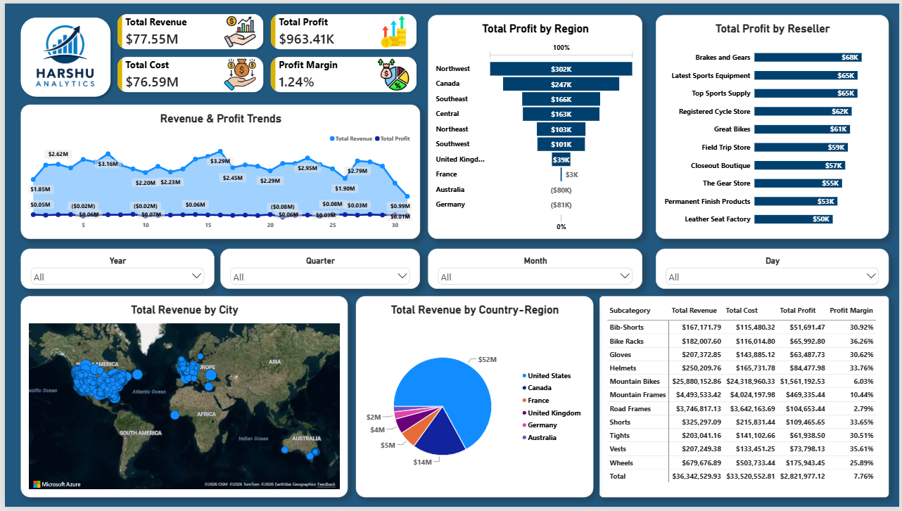
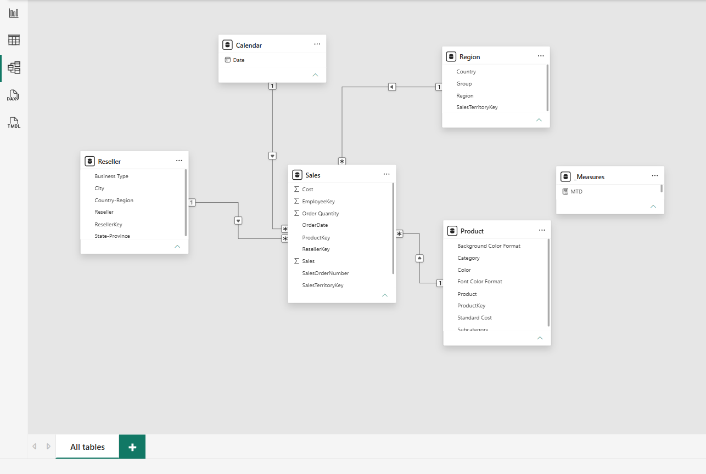

# 📈 Enterprise Sales & Profitability Dashboard (Power BI, SQL & DAX)

### 📌 Project Overview
Designed an end-to-end multi-page executive interface in Power BI to track regional revenue, profit margins, salesperson targets, and monthly/yearly performance trends. Extracted raw transactional records via SQL, engineered clean staging tables in Power Query, and structured a 1:Many Star Schema data model.

---

### 🖼️ Dashboard Preview

---

### 🗂️ Data Model (Star Schema Architecture)

---

### ⚙️ Technical Architecture & Workflow
* **SQL Data Extraction:** Queried transactional sales tables from relational databases using `JOIN`, `GROUP BY`, basic constraints, and aggregations to ensure clean schema ingestion.
* **Power Query (ETL):** Processed unstructured flat files (`Sales.csv`, `Targets.csv`, `Reseller.csv`, `Product.csv`, `Region.csv`, `Salesperson.csv`), resolving text anomalies, format mismatches, and structural errors.
* **Star Schema Modeling:** Established 1:Many relationships between fact ledgers (`Sales`, `Targets`) and multi-tier dimensions (`Product`, `Region`, `Reseller`, `Salesperson`).
* **Explicit DAX Measures:** Authored structured DAX formulas utilizing `CALCULATE` for filtered totals, `SUMX` for line-by-line revenue, `DIVIDE` for profit margin %, and Time Intelligence parameters (`MTD`, `YTD`).
* **Interactive UI/UX:** Built modular KPI cards, contextual drill-downs, dynamic slicers, and regional map layers.

---

### 📂 Repository Files
* `Enterprise_Sales_Dashboard.pbix` – Full Power BI Desktop report and Star Schema data model
* `dashboard_overview.png` & `star_schema_model.png` – Report UI and relational schema snapshots
* `Sales.csv`, `Targets.csv`, `Product.csv`, `Region.csv`, `Reseller.csv`, `Salesperson.csv`, `SalespersonRegion.csv` – Raw source datasets
